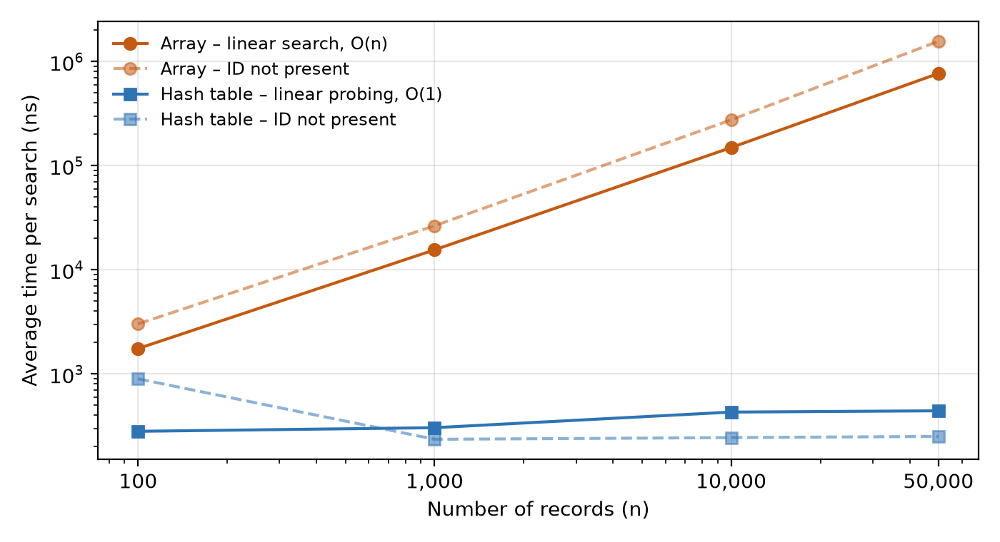
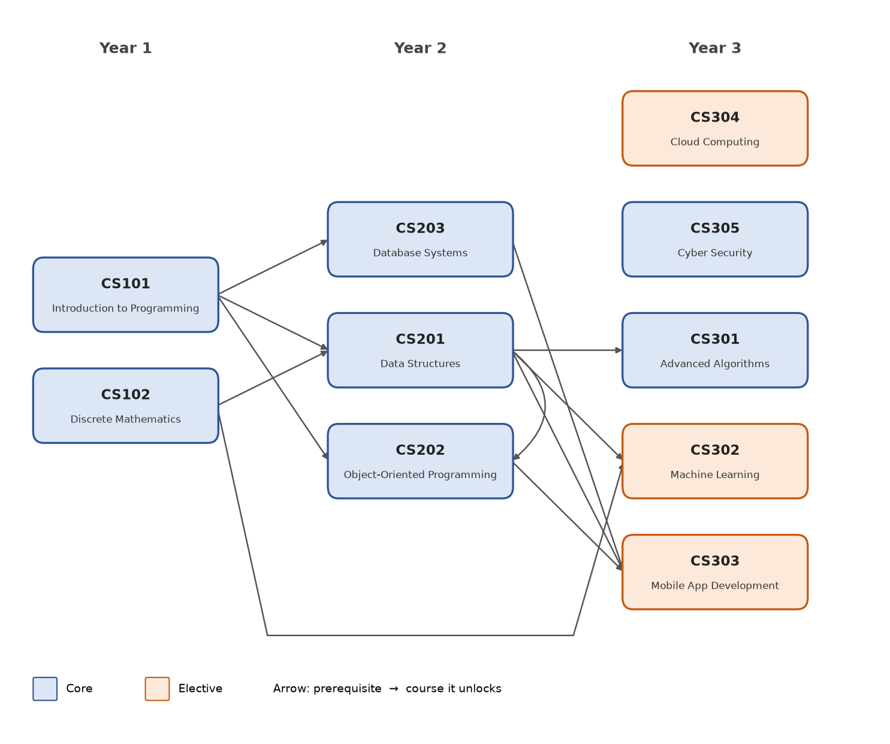
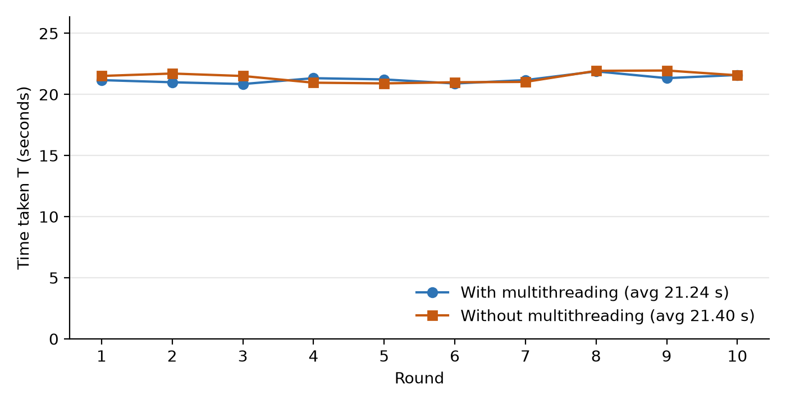
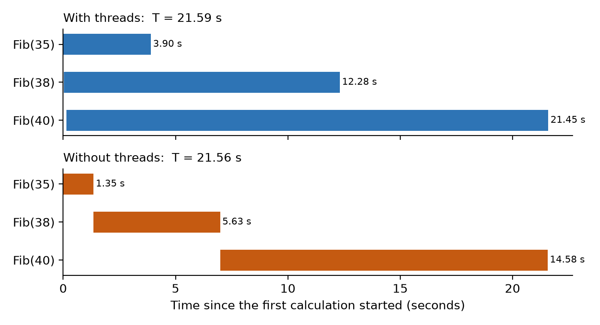

# 5022CMD Advanced Algorithms – Coursework

**Student:** Chan Yin Zheng (P24016573)\
**Module:** 5022CMD Advanced Algorithms, INTI International College Penang


This repository contains my Python solutions to the three questions of the 5022CMD Advanced Algorithms coursework:

| | Question | Topic | Main idea |
|---|---|---|---|
| **Q1** | [Hashing](#question-1--hashing-pharmacy-inventory-system) | Pharmacy Inventory System | Hash table with open addressing and linear probing, compared with a 1-D array |
| **Q2** | [Graph](#question-2--graph-university-course-prerequisite-system) | University Course Prerequisite System | Directed graph with BFS, DFS and Kahn's algorithm |
| **Q3** | [Concurrency](#question-3--concurrent-processing-fibonacci-with-and-without-multithreading) | Fibonacci with and without multithreading | Big-O analysis and the effect of Python's GIL |

---

## Requirements

- **Python 3.10 or newer** (developed and tested with CPython 3.14.7 in PyCharm on Windows)
- The main programs use **only the Python standard library**
- The optional chart scripts (`make_chart.py`) need **matplotlib**:

```bash
pip install matplotlib
```

## How to run

Clone the repository, then run each program **from inside its own folder**:

```bash
git clone https://github.com/yinzheng16/5022CMD-Advanced-Algorithms.git
cd 5022CMD-Advanced-Algorithms/Q1_Hashing
python inventory_system.py
```

| Folder | Program | Command |
|---|---|---|
| `Q1_Hashing` | Inventory system (main program) | `python inventory_system.py` |
| | Search experiment: hash table vs array | `python performance_test.py` |
| | Chart of the experiment | `python make_chart.py` |
| | Unit tests (11) | `python test_hash_table.py` |
| `Q2_Graph` | Course prerequisite system (main program) | `python main.py` |
| | Unit tests (18) | `python test_graph.py` |
| `Q3_Concurrency` | Fibonacci experiment (main program) | `python main.py` |
| | Charts of the experiment | `python make_chart.py` |
| | Unit tests (9) | `python test_fibonacci.py` |

---

## Question 1 – Hashing: Pharmacy Inventory System

A command-line inventory system for a pharmacy. The products are stored in a **hash table built from scratch** using **open addressing with linear probing**.

### Hash table design
- **Hash function:** `key % capacity`, with a **prime** table size (starting at 31) so keys spread evenly
- **Collisions:** linear probing, which tries the next slot (wrapping round to slot 0) until a free one is found
- **Deletion:** a `DELETED` **tombstone** marker, so searches can still find records that were moved past the deleted slot
- **Resizing:** when the load factor goes above **0.7**, the table grows to the next prime of at least double its size, and every record is re-inserted
- **Generic:** `HashTable` and `ArrayStore` never import `Product`, so they can store any value

### Menu
| Option | Feature |
|---|---|
| 1 | Insert a product (shows every slot probed) |
| 2 | Search for a product (hash table and array compared) |
| 3 | Edit a product (press Enter to keep a value; all input checked before saving) |
| 4 | Delete a product (asks for confirmation, leaves a tombstone) |
| 5 | Display all products with stock status (In stock / Low stock / Out of stock / Expired) |
| 6 | View the hash table slots (home slot and probe distance of every record) |

The system starts with 12 pre-defined products. IDs 1001, 1032 and 1063 all hash to slot 9, so collisions and linear probing can be seen straight away.

### Experiment: hash table vs one-dimensional array
`performance_test.py` stores the same randomly generated products (fixed seed 5022) in both structures and times three kinds of search with `time.perf_counter_ns()`:

| Records | Hash table (successful search) | Array (successful search) | Hash table faster by |
|---:|---:|---:|---:|
| 100 | 281 ns | 1,752 ns | 6× |
| 1,000 | 304 ns | 15,550 ns | 51× |
| 10,000 | 430 ns | 149,109 ns | 347× |
| 50,000 | 442 ns | 767,495 ns | **1,736×** |

The hash table time stays almost constant (O(1) on average, 1.35–1.86 probes), while the array time grows in a straight line (O(n)). For an ID that does not exist, the hash table was **6,230 times faster** at 50,000 records.



### Files
| File | Purpose |
|---|---|
| `hash_table.py` | `HashTable`: hash function, linear probing, tombstones, resizing |
| `product.py` | `Product` entity class with stock status and expiry check |
| `sample_data.py` | The 12 pre-defined products |
| `array_store.py` | `ArrayStore`: 1-D array with linear search, used for comparison |
| `display.py` | Boxes and tables for the command-line interface |
| `inventory_system.py` | Main program (menu) |
| `performance_test.py` | Timing experiment, saves `performance_results.csv` |
| `make_chart.py` | Draws `search_performance_chart.png` |
| `test_hash_table.py` | 11 unit tests, including a random test against Python's `dict` |

---

## Question 2 – Graph: University Course Prerequisite System

Courses are the **vertices** and prerequisite links are the **directed edges** (prerequisite → course) of a graph built from scratch.

### Graph design
- Each vertex keeps **two adjacency lists**, `incoming` and `outgoing`, so "what does this course need?" and "what does it unlock?" are each answered by reading one list
- **Breadth-first search** (`hasPath`) rejects any prerequisite that would create a cycle
- **Depth-first search** (`allIncomingReachable`) finds every direct and indirect prerequisite
- **Kahn's algorithm** (`topologicalOrder`) builds a study plan where every prerequisite comes first
- **Generic:** the `Graph` class never uses `Course`, so it works with any hashable vertex

### Menu
| Group | Option | Feature | Type |
|---|---|---|---|
| Browse courses | 1 | View all courses | Mandatory |
| | 2 | View course details | Mandatory |
| | 3 | View prerequisites of a course | Mandatory |
| | 4 | View courses unlocked by a course | Mandatory |
| Manage courses | 5 | Add a new course (maximum 10) | Advanced |
| | 6 | View course profile (core: full details, elective: name only) | Advanced |
| | 7 | Add a prerequisite (self-links, duplicates and cycles rejected) | Advanced |
| | 8 | Remove a prerequisite | Advanced |
| Plan your studies | 9 | Full prerequisite tree (direct and indirect) | Extra |
| | 10 | Study plan by year, checked with Kahn's algorithm | Extra |
| | 11 | Prerequisite map, saved as a picture | Extra |

The system starts with 8 courses (6 core, 2 elective) over Years 1–3 and 10 prerequisite links.



### Files
| File | Purpose |
|---|---|
| `graph.py` | Generic directed `Graph`: required methods plus BFS, DFS and Kahn's algorithm |
| `course.py` | `Course` entity class (core or elective) |
| `course_data.py` | The 8 pre-defined courses and 10 prerequisite links |
| `course_system.py` | `CourseSystem`: connects the graph to the courses and applies the rules |
| `graph_view.py` | Text tree and the graph picture (matplotlib) |
| `display.py` | Boxes and tables (same as Q1) |
| `main.py` | Main program (menu) |
| `test_graph.py` | 18 unit tests |

---

## Question 3 – Concurrent Processing: Fibonacci with and without Multithreading

Fibonacci(35), Fibonacci(38) and Fibonacci(40) are calculated with a **recursive** function, in 10 rounds with **three separate threads** and 10 rounds **without threads**. The time of each round is T = t2 − t1 in nanoseconds.

### Big-O
Counting primitive operations gives T(n) = 11·F(n+1) − 8, so the time complexity is **exponential: Θ(φⁿ) ≈ Θ(1.618ⁿ), usually written O(2ⁿ)**. Option 4 of the program checks that the real number of calls equals 2·F(n+1) − 1 (331,160,281 calls for Fibonacci(40)).

### Results (20-core laptop, Python 3.14.7, GIL enabled)
| Method | Time for all three values | Speed-up |
|---|---:|---:|
| Without threads (average of 10 rounds) | 21.404 s | 1.00× |
| Three threads (average of 10 rounds) | 21.243 s | 1.01× (not significant) |
| Three processes (`multiprocessing`) | 15.452 s | 1.37× |
| I/O-bound task: 3 simulated 1-second downloads with threads | 1.001 s vs 3.001 s | 3.0× |

Multithreading gave **no real speed-up**. In CPython, the **Global Interpreter Lock (GIL)** lets only one thread run Python code at a time, so for CPU-bound work threads are **concurrent but not parallel**. The timeline below shows the three threads taking turns on one processor. Threads do help when the work is waiting for I/O, and separate processes give real parallel speed-up.




### Menu
| Option | Feature |
|---|---|
| 1 | Full experiment: 10 rounds with threads and 10 without |
| 2 | Quick experiment (choose 1–10 rounds) |
| 3 | Timeline of the last round |
| 4 | Big-O check: count the calls |
| 5 | Extra: I/O-bound task with threads |
| 6 | Extra: the same Fibonacci job with multiprocessing |

### Files
| File | Purpose |
|---|---|
| `fibonacci.py` | Recursive `fibonacci()` and the call-counting helpers |
| `experiment.py` | `FibonacciThread`, one round with and without threads, T = t2 − t1 |
| `timeline.py` | Text timeline of one round |
| `extra_demos.py` | I/O-bound demo and multiprocessing demo |
| `display.py` | Boxes and tables (same as Q1) |
| `main.py` | Main program (menu) |
| `make_chart.py` | Draws `rounds_chart.png` and `timeline_chart.png` from the CSV files |
| `test_fibonacci.py` | 9 unit tests |

---

## Repository structure

```
5022CMD-Advanced-Algorithms/
├── README.md
├── .gitignore
├── Q1_Hashing/       Hash table + Pharmacy Inventory System
├── Q2_Graph/         Directed graph + Course Prerequisite System
└── Q3_Concurrency/   Fibonacci with and without multithreading
```

## Testing

Every question has its own `unittest` file, and all **38 tests pass** (11 + 18 + 9). Each program was also tested by hand with valid and invalid input. The test cases and their screenshots are in the report.